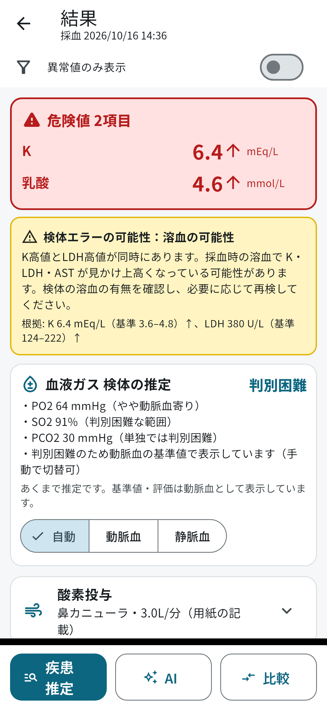
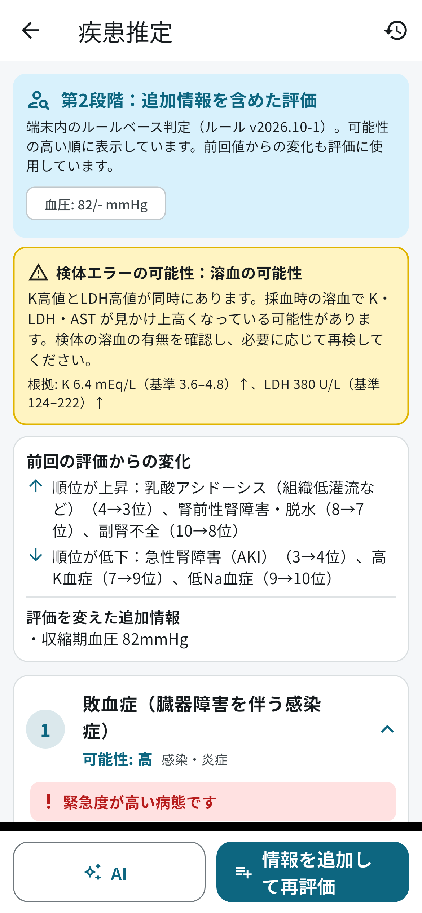
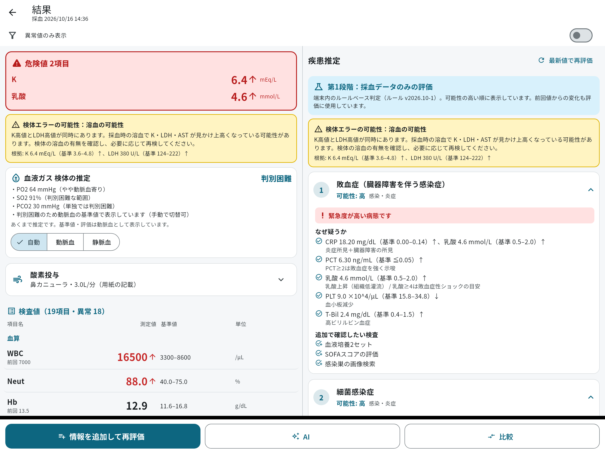

# LabSight（採血データ解析アプリ）

医師・看護師・救急救命士などの医療従事者向けの診療サポートアプリです。
採血結果を取り込み、異常値の表示、疑われる疾患とその根拠、AIによる解説を示します。
Flutter で作っているので、1つのコードで iOS と Android の両方に対応します。

> 本アプリは医療従事者の診療を補助する目的で提供するものであり、診断・治療を行うものではありません。表示される疾患・A/V推定・AIアドバイスは参考情報です。最終的な判断は必ず医療従事者自身が行ってください。本アプリの利用により生じたいかなる損害についても、開発者は責任を負いません。

| 結果 | 疾患推定（第2段階） | タブレット（2画面） |
|---|---|---|
|  |  |  |

※ スクリーンショットはテスト環境で生成したものです。

## 機能

| 機能 | 内容 |
|---|---|
| 読み込み | カメラ（書類の輪郭を自動検出して撮影）、アルバムの写真・スクリーンショット、手入力 |
| OCR（端末内） | iOS は Vision、Android は ML Kit（日本語）を使用。画像は保存も送信もしない |
| 確認画面 | 読み取り後は必ず表示。読み取りが不確かな値は黄色で示し、修正を促す |
| 別名辞書 | Cr / CRE / クレアチニン などの表記を同じ項目にまとめる。全角文字にも対応 |
| 誤読検出 | ありえない値を警告し、正しい値の候補を示す（例: Na 14 → 140?）。単位の換算にも対応 |
| 対応項目 | 血算・凝固・肝胆膵・腎/電解質・蛋白/炎症・代謝/内分泌・脂質・心筋・血液ガス・その他（全82項目）。ユーザーが項目を追加することも可能 |
| 異常値表示 | 高値は赤＋↑、低値は青＋↓、危険値は赤背景で画面上部にまとめる。「異常値のみ表示」の切替あり |
| 基準値 | 優先順は、用紙の記載 ＞ 設定 ＞ 既定値（性別・動脈血/静脈血に応じて切替） |
| 疾患推定 | 端末内のルールで判定（64病態）。第1段階は採血データのみで評価。第2段階は追加情報を入れて再評価し、順位の変化とその要因を表示。評価履歴も保存 |
| 組み合わせ判定 | BUN/Cre比、AST/ALT比、AG・補正AG・Δ比、補正Ca、eGFR、P/F比、A-aDO2、Winter式、浸透圧ギャップなど。前回値からの変化（KDIGOによるAKI判定など）も使う |
| 検体エラー | 溶血、偽性高K、EDTA混入、輸液混入、解糖、偽性低Na、血液ガスへの気泡混入などの可能性を警告 |
| A/V推定 | PO2・SO2・PCO2から動脈血か静脈血かを推定し、根拠を表示。用紙の記載を優先し、手動でも切替可能 |
| 酸素投与 | FiO2・流量・器具（カニューラ・マスク・リザーバー・室内気など）を検出。記載がなければ「記載なし（未確認）」と表示して入力欄を出す。動脈血のときは P/F比を計算 |
| AIアドバイス | Claude API を使用（オンライン時のみ）。病態の整理・追加検査・注意点・前回からの変化を解説し、チャットで追加質問できる |
| フォルダ・比較 | 患者・ケースごとのフォルダに採血日時ごとに保存。前回値と今回値の比較（改善は緑、悪化は赤＋矢印）、推移グラフ、比較後の再評価 |
| 削除 | データ単位・フォルダ単位で削除（確認ダイアログあり）。自動削除も設定可能（1日〜1年） |
| セキュリティ | DB を SQLCipher で暗号化（鍵は Keychain/Keystore に保存）。パスコード・生体認証、自動ロック、アプリ切替画面での内容非表示、バックアップの対象外設定 |
| 表示 | 白・ライトグレーを基調に、メインカラーはティール。数値は等幅で大きく表示。文字サイズの変更（85〜160%）、ダークモード、手袋でも押せる大きなボタン |

### 個人情報の扱い

- 「氏名・生年月日・ID・カルテ番号」などを含む行は、OCR の読み取り対象から除外します。値も原文も保存しません。年齢と性別だけは、判定の参考として拾います。
- AI に送るのは、検査値（計算値・前回値を含む）、年齢・性別、端末内の判定結果のみです。氏名・フォルダ名・日付・自由記載（症状や既往歴など）は送りません。送る前に内容を画面で確認できます。
- チャットに個人情報らしき入力があると警告します。

## 開発環境・ビルド

| | 必要なもの |
|---|---|
| 共通 | Flutter 3.47 以上（Dart 3.13） |
| iOS | Mac と Xcode、CocoaPods。iOS 15.5 以上 |
| Android | Android Studio。Android 7.0（API 24）以上 |

```sh
cd labsight
flutter pub get
flutter test             # 単体テスト＋画面の通しテスト
flutter run              # 接続した実機・シミュレータで起動
flutter build apk        # Android
flutter build ipa        # iOS（Xcode で署名の設定が必要）
```

- iOS で初めてビルドするときは `cd ios && pod install` が自動で実行されます。
- Android の書類スキャナ（ML Kit Document Scanner）には Google Play 開発者サービスが必要です。使えない端末では、自動的に通常のカメラ撮影に切り替わります。

## AIアドバイスの設定

1. Anthropic Console（https://console.anthropic.com）で API キーを発行します。
2. アプリの「設定 → APIキー・モデル」に入力します。キーは端末のセキュア領域に保存されます。
3. 既定のモデルは `claude-opus-5-5` です。設定画面から変更できます。

API の利用料金は、キーの持ち主に請求されます。

## 判定ルールの更新

疾患推定のルールは `assets/rules/disease_rules.json` に定義しています。

- アプリの「設定 → 判定ルール → ルールJSONを読み込む」から JSON を貼り付けると、アプリを更新せずにルールを差し替えられます。「組み込みに戻す」で元に戻せます。
- 条件の書き方は `lib/services/rule_engine.dart` の先頭のコメントを参照してください（`lab` / `delta` / `ctx` / `kw` / `any` / `all` / `not` など）。
- 項目の基準値・危険値・誤読判定の範囲・別名は `lib/data/lab_catalog_data.dart` にあります。

> 基準値・危険値・判定ルールは、一般的な目安をもとにした初期値です。運用する前に、施設の基準値や臨床医によるレビューを経てから使ってください。

## ディレクトリ構成

```
lib/
  main.dart / app.dart        起動、テーマ、ロック制御
  theme.dart                  色（高値=赤・低値=青・危険値・要確認=黄）、免責文
  data/lab_catalog_data.dart  検査項目マスタ（基準値・危険値・別名・単位換算）
  models/                     項目定義、採血データ、追加情報、フォルダ
  services/
    lab_catalog.dart          別名辞書、基準値の解決、高低判定、誤読検出
    ocr_service.dart          OCR・書類スキャン（iOS: Vision / Android: ML Kit）
    ocr_parser.dart           OCR結果の解析（行の結合、値・単位・H/L・基準値、個人情報行の除外、A/V・酸素の検出）
    clinical_calc.dart        計算値、A/V推定、FiO2推定
    rule_engine.dart          ルールベースの疾患推定、検体エラー、再評価の差分
    ai_service.dart           Claude API、送信データの作成（個人情報を除く）
    database.dart             暗号化DB（SQLCipher）
    settings.dart             設定・パスコード・APIキー
  screens/                    各画面
ios/Runner/AppDelegate.swift  Vision による OCR、VisionKit による書類スキャン
assets/rules/disease_rules.json  判定ルール
test/                         ロジックの単体テスト、画面の通しテスト
```
